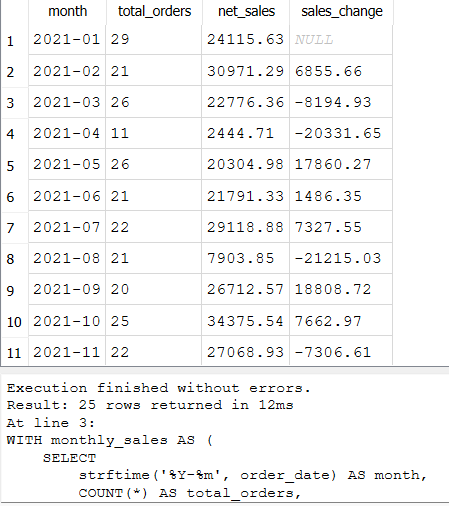
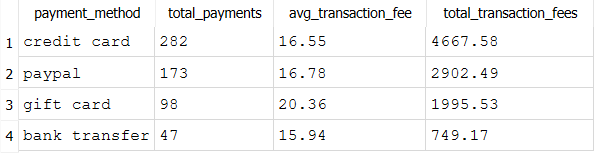
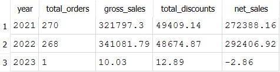

# E-commerce Sales Data Cleaning & Analysis

## Overview
A SQL portfolio project focused on cleaning e-commerce data, identifying data-quality issues, and analysing sales, customers, and payment methods using SQLite.

## Tools
- SQLite
- DB Browser for SQLite
- SQL (CTEs, window functions, joins, aggregations, and CASE statements)

## Dataset
[E-commerce Sales Insights](https://databasesample.com/datasets/ecommerce-sales-insights)

The dataset contains five tables: customers, orders, products, categories, and payments.

## Key Insights
- **Sales growth:** Net sales increased from 272,388.16 in 2021 to 292,406.92 in 2022, an increase of approximately 7.3%.
- **Seasonality:** September recorded the highest combined monthly net sales at 70,302.32 across the available years.
- **Payment methods:** Credit cards were the most frequently used payment method, accounting for 282 of 600 payments.
- **Data quality:** 159 orders had discounts greater than their order amounts, requiring further investigation.
- **Missing data:** 61 orders had missing total amounts, 33 products had missing prices, 25 customers had missing cities, and 2 categories had missing names.

## SQL Analysis Results

### Monthly Sales Performance

### Payment Method Analysis

### Annual Sales Performance

## Project Structure
- `data/raw/` — Original CSV files
- `sql/01_data_quality_checks.sql` — Data-quality checks
- `sql/02_data_cleaning.sql` — Cleaned table creation
- `sql/03_sales_analysis.sql` — Sales and customer analysis
- `ecommerce_sales.db` — Local SQLite database, excluded from Git

## Methods
- Checked missing values, duplicate IDs, and suspicious discounts.
- Standardised text fields and handled blank values.
- Created cleaned tables while preserving raw tables.
- Used CTEs and window functions to analyse monthly sales trends.
- Analysed customer spending, payment methods, annual performance, and sales by city.

## Notes
- Orders with discounts exceeding their total amounts were flagged rather than automatically corrected.
- The 2023 results contain only one order, so they should not be compared directly with full-year results.
- Product-level revenue and cancellation analysis were excluded because the available tables do not contain the required product-order relationship or cancellation status.

## How to Run

1. Download the dataset CSV files and place them in `data/raw/`.
2. Open `ecommerce_sales.db` in DB Browser for SQLite.
3. Import the CSVs into tables named `categories_raw`, `customers_raw`, `orders_raw`, `payments_raw`, and `products_raw`.
4. Execute `sql/02_data_cleaning.sql` to create the cleaned tables.
5. Execute `sql/01_data_quality_checks.sql` to check for missing data and suspicious values.
6. Execute `sql/03_sales_analysis.sql` to run the analyses.

**Note:** Run the cleaning script first because the quality checks and sales analysis depend on the cleaned tables.

## Disclaimer
This project is for portfolio and learning purposes. Monetary figures are presented in the dataset's original units.
